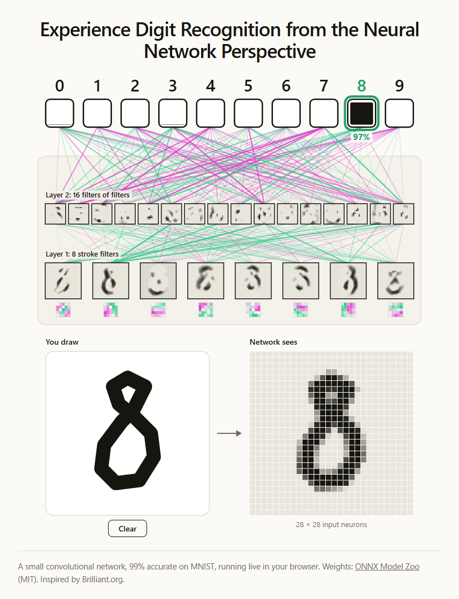
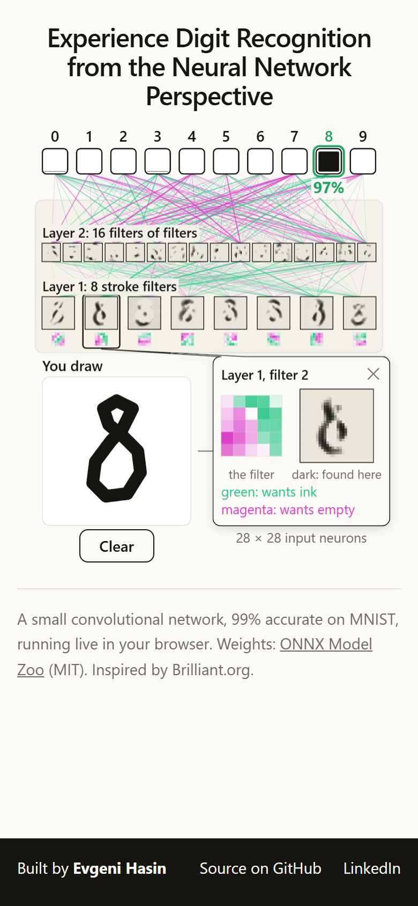

> **This repo has moved to [ehasin/neural-networks-in-action](https://github.com/ehasin/neural-networks-in-action).** This copy is archived and no longer updated.

# Visual Digit Recognition – CNN in action

Draw a digit and watch a convolutional neural network read it, layer by layer, live in your browser.

**▶ Try it: [hasin.eu/projects/cnn-digit-recognition-in-action](https://hasin.eu/projects/cnn-digit-recognition-in-action/)**. Works on desktop and phone.

<p>
  
  
</p>

## Why I built it

Machine learning is usually explained with formulas or shown as a black box: a picture goes in, an answer comes out. I wanted a way to *see* how a neural network works and get an intuitive feel for it, without any math.

So this demo hides nothing. Every step the network takes is on screen and updates as you draw:

- what the network actually receives: not your drawing, but 784 numbers
- how its first layer looks for simple strokes, and its second layer for combinations of them
- which signals push towards which answer, and how sure it ends up

Draw a clean 8 and watch it light up. Then draw a sloppy 6, or a letter, and see where it goes wrong. Playing with it shows what a convolutional neural network (CNN) learns, and where its limits are, faster than reading about it.

## What you see

- **You draw → Network sees.** Your pen path becomes the network's real input: 28 × 28 values, one per input neuron, resized and centred the way the MNIST training digits were.
- **Layer 1.** 8 small 5×5 filters slide over the input. Each map is dark where its filter's pattern was found. In the filters, green wants ink and magenta wants empty.
- **Layer 2.** 16 filters run over the layer 1 maps, after shrinking them to half size. They pick up combinations of strokes: corners, loops and crossings.
- **Outputs.** 10 boxes; how full each is shows how sure the network is. The answer gets a green outline and its confidence in %.
- **Lines.** Green lines push the next layer up, magenta lines push it down.
- **Zoom.** Click or tap any filter or map to open it enlarged in a bubble. Click it again, or the bubble, to close it.
- **Clear.** The button, or the C key.

## Run it

There is no build step and no dependencies, only static files.

```
node serve.mjs
```

Then open http://localhost:5317. Any static file server works.

## How it's built

| File | Role |
| --- | --- |
| `index.html` | Page and styles |
| `app.js` | Drawing pad, canvas rendering, hover |
| `cnn.js` | The network's forward pass in plain JavaScript (about 5 ms) |
| `preprocess.js` | Redraws the pen path MNIST-style: thin stroke, fit to 20 × 20, centred by mass |
| `model/cnn.json` | Weights (54 KB) |
| `tools/convert-cnn.mjs` | Converts the original ONNX model to `cnn.json` by reading the protobuf directly |
| `tools/render-gtm-video*.cjs`, `tools/prepare-vertical.cjs` | Render the 1 → 4 → 9 videos frame by frame with the app's own renderer and model |
| `assets/` | The videos, the link preview image and their source material |
| `serve.mjs` | Tiny local static server |
| `vercel.json` | Hosting: serves the page at `/projects/cnn-digit-recognition-in-action/` |

Network: conv 5×5 (8 filters) → ReLU → max-pool 2 → conv 5×5 (16 filters) → ReLU → max-pool 3 → dense 256 → 10 → softmax. It is 98.9% accurate on the MNIST test set.

## Credits

- Model: [mnist-8 from the ONNX Model Zoo](https://github.com/onnx/models/tree/main/validated/vision/classification/mnist), MIT license, trained by Microsoft with CNTK.
- Training data: the [MNIST database](https://yann.lecun.com/exdb/mnist/) by Yann LeCun, Corinna Cortes and Christopher Burges.
- Inspired by Brilliant.org's *Introduction to Neural Networks*.

Built by Evgeni Hasin.
